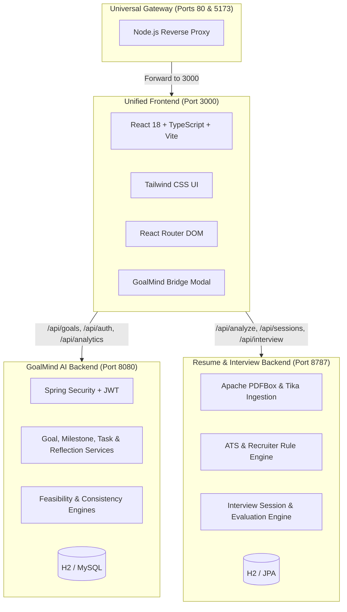

# GoalMind AI — Unified Career Intelligence & Goal Achievement Platform

[](https://adoptium.net/)
[](https://spring.io/projects/spring-boot)
[](https://react.dev/)
[](https://www.typescriptlang.org/)
[](https://vitejs.dev/)
[](https://tailwindcss.com/)
[](LICENSE)

An enterprise-grade, full-stack career acceleration platform combining **AI-driven personal goal execution**, an **ATS Resume Analyzer & Document Architect**, and an **Interactive Technical Interview Simulator** into a seamless, unified experience.

---

## 🌟 The Unified Vision

Most career tools operate in silos: resume builders only format text, interview prep apps test isolated algorithms, and goal planners track static checkboxes.

🌐Live Demo-https://goalmind-ai.onrender.com/

**GoalMind AI bridges these domains into a closed-loop growth flywheel:**

```
   ┌─────────────────────────────────────────────────────────────┐
   │                   RESUME ANALYZER (ATS)                     │
   │  • PDF / DOCX Ingestion       • Recruiter Scoring           │
   │  • Job Vacancy Matching       • ATS Keyword Gaps            │
   └──────────────────────────────┬──────────────────────────────┘
                                  │
                       Identifies Skill Gaps
                                  │
                                  ▼
   ┌─────────────────────────────────────────────────────────────┐
   │                       GOALMIND AI                           │
   │  • Feasibility Calculator     • AI Roadmap Builder          │
   │  • Focus Timer & Reflections  • Consistency Scoring Engine  │
   │  • Adaptive Recovery Planner  • SWOT Performance Analysis   │
   └──────────────────────────────┬──────────────────────────────┘
                                  │
                       Validates Topic Mastery
                                  │
                                  ▼
   ┌─────────────────────────────────────────────────────────────┐
   │                   INTERVIEW SIMULATOR                       │
   │  • 100+ FAANG Question Bank  • Live AI Interviewer Hints    │
   │  • STAR Rubric Evaluations    • Delivery Pacing & Telemetry │
   └─────────────────────────────────────────────────────────────┘
```

---

## 🚀 Core Platform Modules

### 1. 🎯 GoalMind AI (Goal Achievement Engine)
- **Mathematical Feasibility Engine**: Analyzes deadline, difficulty, daily available hours, and existing velocity to classify goals as *Feasible*, *Challenging*, or *At-Risk* before committing.
- **Dynamic AI Roadmap Generation**: Automatically breaks goals into sequential milestones and manageable daily tasks.
- **Deep Work Focus Timer**: Integrated Pomodoro timer with distraction logging and empirical time tracking.
- **Consistency Analysis Engine**: Quantifies user adherence across 30-day windows and calculates streak resilience.
- **Adaptive Recovery Planning**: Re-calibrates slipped schedules intelligently without silently deleting deadlines.

### 2. 📄 AI Resume Analyzer & Document Architect
- **Multi-Format Extraction**: Parses raw text, `.pdf` (via Apache PDFBox and Tika), `.docx`, and Markdown files with column-aware text stripping.
- **Dual-Lens Scoring**:
  - **ATS Compatibility Score (0–100)**: Detects standard section headers, keyword density, parseability, and formatting traps.
  - **Recruiter Impact Score (0–100)**: Evaluates quantifiable achievements, strong action verbs, and conciseness.
- **Real-Time AI Bullet Rewriter**: Re-writes weak bullet points into high-impact, metric-driven statements.
- **RTF Document Generator**: Exports professional resumes across 4 designer templates (*Classic*, *Modern*, *Sidebar*, *Bold*).
- **Live Vacancy Finder**: Matches extracted resume skill vectors against active LinkedIn and Indeed job queries.

### 3. 🎙 Technical Interview Simulator
- **FAANG+ Question Bank**: 100+ curated technical questions across Google, Meta, Amazon, Microsoft, Netflix, Apple, Uber, Airbnb, Stripe, and Snowflake.
- **Multi-Level Practice**: Configurable for Junior, Mid-Level, Senior, and Staff engineering tiers.
- **Interactive Assistance**: Real-time interviewer hints, candidate clarifying questions, and contextual follow-ups.
- **STAR Rubric Evaluation**: Instant scoring across *Relevance*, *Evidence*, *Reasoning*, *Clarity*, and *Self-Reflection*.
- **Speech & Delivery Telemetry**: Measures words per minute (WPM), filler word usage, and personal ownership language ("I" vs. "We").

### 4. 🔗 The Career Learning Bridge
- Every skill gap detected in the **Resume Analyzer** and every improvement point identified in the **Interview Simulator** features a **"Master in GoalMind AI"** bridge.
- Clicking the bridge prompts user confirmation and pre-fills GoalMind's AI goal creator with target skills, recommended daily commitment, and category metadata.

---

## 🏛 Architecture & Tech Stack



---

## ⚡ Quickstart

### Prerequisites
- **Java 21 LTS** (`java -version`)
- **Node.js 20+** and **npm** (`node -v`)

### Single-Command Start (Windows)
Run the automated unified platform launcher:
```powershell
powershell -ExecutionPolicy Bypass -File start.ps1
```
Or use the batch script:
```cmd
start.bat
```

The script automatically:
1. Validates and starts the **GoalMind AI Backend** on `http://localhost:8080`.
2. Starts the **Resume & Interview Backend** on `http://localhost:8787`.
3. Launches the **Unified Vite Frontend** on `http://localhost:3000`.
4. Activates the **Universal Port Gateway** on `http://localhost:5173` and `http://localhost:80`.

Open your browser at:
👉 **`http://localhost:3000`**

---

## 🧪 Comprehensive Automated Testing

A dedicated end-to-end integration test suite is included to verify all 31 operational scenarios across all modules:

```bash
node comprehensive-test-suite.js
```

### Verified Test Matrix (100% Pass Rate):
- ✅ **Resume Analyzer**: Health checks, model config, plain text scoring, PDF extraction, invalid input rejection, bullet rewrite engine, RTF document export, live vacancies matching.
- ✅ **Interview Simulator**: Question bank retrieval, company filters, readiness dashboard, session creation, hint generation, candidate clarifications, answer submission, STAR evaluation, session replay.
- ✅ **GoalMind AI**: Registration with strong credentials, duplicate username rejection, weak password rejection, authentication, AI feasibility check, bridged goal creation, AI roadmap generation, roadmap application to calendar, consistency analytics, dashboard metrics.

---

## 🛡 Security & Design Standards

- **Strict Username & Strong Password Policy**: Enforces unique username registration and minimum 8-character passwords with alphanumeric requirements.
- **JWT Stateless Security**: All GoalMind endpoints require valid JWT bearer tokens with user tenancy isolation.
- **Explicit User Consent**: Cross-system bridging and calendar modifications always require explicit user confirmation.
- **Resilient Fallback Mode**: Complete offline functionality with deterministic rule engines when external LLM API keys are not supplied.

---

## 📄 License

This project is licensed under the [MIT License](LICENSE).
